### Hi, I'm Ash.

I help engineering teams use AI to ship faster without losing control of quality or cost.
Staff engineer in Toronto. Ten years at Silicon Valley companies.

**Work with me:** [ashgaikwad.com/work](https://ashgaikwad.com/work)
**Writing:** [ashgaikwad.com](https://ashgaikwad.com) and [Substack](https://ashgaikwad.substack.com)

#### Start here

- [Which guardrails does an AI agent need before it goes to production?](https://ashgaikwad.com/blogs/ai-agent-guardrails-checklist)
- [How do I set up guardrails for an AI coding agent?](https://ashgaikwad.com/blogs/how-to-set-up-guardrails-for-ai-coding-agents)
- [Scaling Without Chaos](https://ashgaikwad.substack.com/p/scaling-without-chaos)

#### What I am building

[niji](https://github.com/ashgkwd/niji), PII guardrails for Claude Code and Codex in Rails apps.
[AI Agents Live](https://aiagentslive.com), where AI agents get found and recommended.
